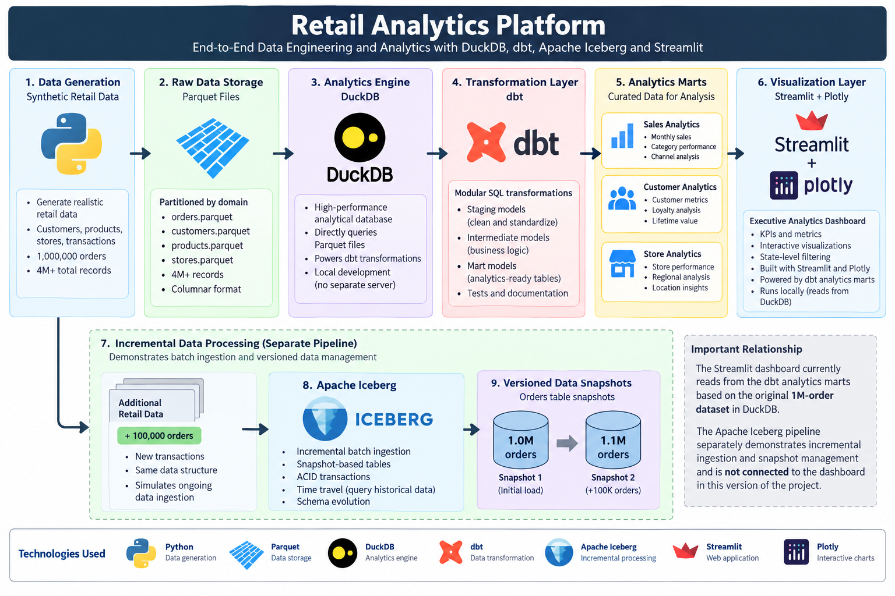

# Retail Analytics Platform

An end-to-end retail data engineering and analytics platform built to process and analyze millions of simulated retail transactions using Python, DuckDB, dbt, Apache Iceberg, Parquet, and Streamlit.

The project simulates the data infrastructure of a large omnichannel retailer, transforming raw transactional data into tested analytics models and an interactive executive dashboard.

## Architecture



The platform contains two primary workflows:

1. **Analytics Pipeline** — Python-generated retail data is stored in Parquet, queried with DuckDB, transformed and tested with dbt, and exposed through analytics marts consumed by a Streamlit dashboard.
2. **Incremental / Iceberg Pipeline** — New transaction batches are appended to an Apache Iceberg table to demonstrate incremental ingestion, snapshots, and versioned data management.

The current Streamlit dashboard reads from the dbt analytics marts in DuckDB. The Apache Iceberg workflow is a separate pipeline used to demonstrate lakehouse table-management concepts.

## Dashboard


The executive dashboard provides views into:

- Total revenue, orders, units sold, and customers
- Monthly sales performance
- Revenue by product category
- Store vs. online sales
- Loyalty-member spending
- Top-performing retail stores
- Interactive store filtering by state

The modeled dataset represents approximately **$3.02 billion in simulated sales revenue** across **1 million baseline orders**.

## Dataset

The baseline dataset contains more than **4 million records** across several retail entities.

| Dataset | Records |
|---|---:|
| Customers | 100,000 |
| Products | 10,000 |
| Stores | 2,000 |
| Orders | 1,000,000 |
| Order Items | 3,000,798 |
| **Total** | **4,112,798** |

An additional batch of **100,000 orders** was generated for the incremental-processing workflow, bringing the Apache Iceberg orders table to **1.1 million orders**.

The data is synthetic and was generated specifically for this project.

## Technology Stack

| Technology | Purpose |
|---|---|
| Python | Synthetic data generation and ingestion workflows |
| SQL | Data transformation and analytics |
| Parquet | Columnar storage for raw datasets |
| DuckDB | Local analytical query engine |
| dbt Core | Data transformation, modeling, testing, and documentation |
| Apache Iceberg | Snapshot-based table management and incremental ingestion |
| Streamlit | Interactive analytics application |
| Plotly | Dashboard visualizations |

## Data Pipeline

### 1. Data Generation

Python scripts generate simulated retail data for customers, products, stores, orders, and order items.

The baseline transaction dataset contains:

- 1,000,000 orders
- 3,000,798 order items
- Store and online sales channels
- Transaction history from January 2024 through September 2026

### 2. Parquet Storage

Generated datasets are written to Parquet files.

Large transaction datasets are split across multiple files, allowing DuckDB to query them efficiently using wildcard scans without requiring the data to first be loaded into a traditional database server.

### 3. DuckDB Analytics

DuckDB provides the analytical engine for the project.

It queries Parquet files directly and also serves as the database used by dbt for transformed models and analytics marts.

### 4. dbt Transformation Layer

dbt transforms raw retail data into reusable analytical models.

The project uses three modeling layers:

```text
Raw Parquet Data
       |
       v
Staging Models
       |
       v
Intermediate Models
       |
       v
Analytics Marts
```

Staging models standardize the source datasets, while downstream models apply business logic and produce analytics-ready tables.

The primary marts include:

- `sales_by_category`
- `sales_by_channel`
- `customer_metrics`
- `store_performance`
- `monthly_sales`

### 5. Data Quality Testing

dbt tests validate important assumptions throughout the transformation pipeline.

Tests include:

- Not-null validation
- Unique-key validation
- Accepted-value checks
- Referential integrity / relationship tests

The final dbt build executes **55 models and tests successfully with zero errors**.

```text
PASS=55
WARN=0
ERROR=0
SKIP=0
TOTAL=55
```

## Incremental Processing

The project also simulates an incoming batch of new retail transactions.

A second dataset adds:

```text
100,000 new orders
299,891 new order items
```

The incremental workflow demonstrates how a data platform can process newly arriving data without rebuilding the original dataset.

A dbt incremental model uses `order_id` as the unique key and only processes records beyond the highest previously loaded order ID.

This approach is appropriate for the simulated monotonically increasing IDs used in this project. Production systems may instead use ingestion timestamps, merge/upsert strategies, or change data capture.

## Apache Iceberg

Apache Iceberg was added as a separate lakehouse workflow to demonstrate table-level management on top of Parquet data.

The Iceberg `retail.orders` table contains two snapshots:

```text
Snapshot 1
1,000,000 orders
Maximum Order ID: 1,000,000

          +100,000 orders

Snapshot 2
1,100,000 orders
Maximum Order ID: 1,100,000
```

This demonstrates concepts including:

- Incremental batch ingestion
- Snapshot-based table state
- Atomic appends
- Table metadata
- Historical table versions
- Time-travel concepts

The project uses a local SQLite-backed Iceberg catalog and a local Iceberg warehouse.

## Analytics Results

The baseline analytics pipeline processes:

```text
Total Revenue:     $3.02B
Total Orders:      1,000,000
Units Sold:        6,000,298
Customers:         100,000
```

Store transactions account for approximately **70% of revenue**, while online transactions account for approximately **30%**.

Because the dataset is synthetically generated without intentionally assigning stronger purchasing behavior to loyalty members or individual stores, some customer and store metrics are intentionally similar rather than containing manufactured trends.

## Project Structure

```text
retail-analytics/
|
├── dashboard/
│   └── app.py
|
├── data/
│   ├── raw/
│   ├── incoming/
│   ├── processed/
│   └── iceberg/
|
├── docs/
│   └── images/
│       ├── architecture.png
│       └── dashboard.png
|
├── scripts/
│   ├── generate_data.py
│   ├── generate_transactions.py
│   ├── generate_incremental_batch.py
│   ├── create_iceberg_orders.py
│   ├── load_iceberg_orders.py
│   └── append_iceberg_orders.py
|
├── sql/
│   └── product_analysis.sql
|
├── retail_analytics/
│   ├── models/
│   │   ├── staging/
│   │   ├── intermediate/
│   │   └── marts/
│   ├── dbt_project.yml
│   └── ...
|
├── README.md
└── requirements.txt
```

## Running the Dashboard

Create and activate a Python virtual environment:

```bash
python3 -m venv venv
source venv/bin/activate
```

Install the project dependencies:

```bash
pip install -r requirements.txt
```

Build the dbt models:

```bash
cd retail_analytics
dbt build
cd ..
```

Start the dashboard:

```bash
streamlit run dashboard/app.py
```

Streamlit will provide the local address for the dashboard in the terminal.

## What I Learned

Building this project gave me hands-on experience with how different parts of a modern analytics platform work together.

Instead of treating each technology as an isolated tool, I used each one for a specific layer of the system:

- Python for data generation and ingestion
- Parquet for efficient columnar storage
- DuckDB for analytical querying
- dbt for transformations, testing, and dependency management
- Apache Iceberg for snapshot-based table management
- Streamlit and Plotly for presenting analytics to users

The project also helped me understand the difference between processing data, transforming it into reliable analytical models, managing evolving datasets, and presenting those results through a business-facing application.

## Future Improvements

Potential extensions include:

- Cloud object storage
- Automated orchestration
- CI/CD for dbt models
- Additional incremental ingestion strategies
- Production-grade catalog infrastructure
- Expanded dimensional modeling
- Deployment of the analytics dashboard

---

**Built with Python, SQL, DuckDB, dbt, Apache Iceberg, Parquet, Streamlit, and Plotly.**
